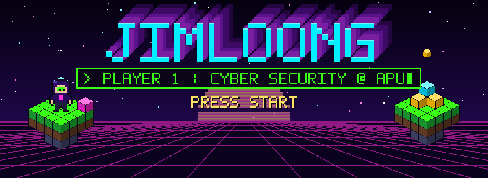
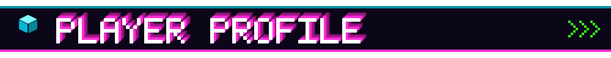
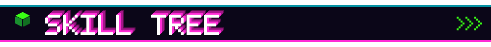
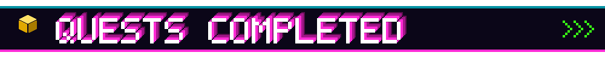
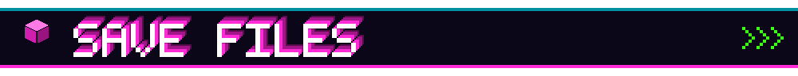
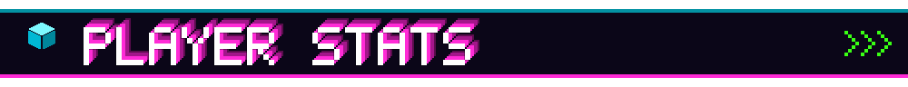
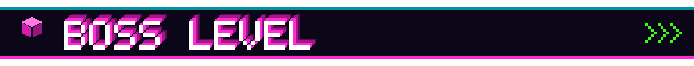
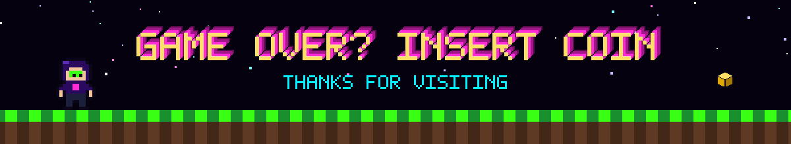

  

  
  
  

  

**⚔️ OFFENSE & ANALYSIS**

  
  
  
  

**🛡️ CODE & SYSTEMS**

  
  
  
  
  

**🎯 TRAINING GROUNDS**

  
  

| 🎮 EVENT | 🗺️ TYPE | 🏅 RESULT |
|---|---|---|
| *PICO CTF* | Capture The Flag | *Top 20* |
| *ICTF* | Capture The Flag | *Top 20* |
| *Hackathon name here* | Hackathon | *what you built / award* |

| 💾 SAVE SLOT | 📝 DESCRIPTION | ⚙️ TECH |
|---|---|---|
| 🐍 [Python Application](https://github.com/jimloong/Projects) | Semester 3 Python app | Python |
| 🌐 [Group Web Project](https://github.com/jimloong/Projects) | Team-built website | HTML · CSS · JS |
| 📋 [Software Engineering Assignment](https://github.com/jimloong/Projects) | Requirements, design and test plan | Docs · Testing |

  
  

  

  

  

  

